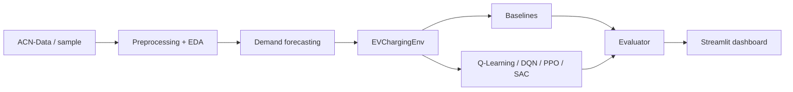

# ⚡ ChargeSmart

**Reinforcement Learning-Based Intelligent EV Charging and Smart Grid Optimization**
UCS760 - Edge AI and Robotics: Reinforcement Learning & Conversational AI (lab project)

> **Status & honesty notes.** ChargeSmart is a *simulation prototype*; it makes no claim of real-grid deployment.
> The numbers below were produced on a **synthetic, ACN-schema sample** (not real ACN-Data) because ACN-Data needs an API
> token. Re-run with real data using the commands below. RL agents were trained briefly on a single CPU with one training
> seed; in our runs they **improved on uncontrolled charging but did not beat the best hand-written rule-based policy**.

## 1. Overview, problem and motivation
Simultaneous EV charging creates demand peaks, grid overload, higher cost and missed departures. Fixed schedules or
"charge on arrival" ignore deadlines, prices and grid limits. ChargeSmart builds a pipeline - data analysis, demand
forecasting, a Gymnasium charging simulator, RL agents, baselines and a Streamlit dashboard - to study whether RL can
schedule charging better.

**Objectives:** analyse charging-session data; forecast demand; simulate multi-EV charging; learn charging policies with RL;
minimise cost and peak load while meeting departure requirements; compare against traditional strategies; provide an
interactive dashboard.
**Applications:** workplace/campus charging hubs, fleet depots, smart-building energy management.

## 2. Dataset
Primary source: Caltech **ACN-Data** (https://ev.caltech.edu/dataset, docs https://acnportal.readthedocs.io/,
https://github.com/zach401/acnportal). Citation: Lee, Z. J., Li, T., Low, S. H., "ACN-Data: Analysis and Applications of an
Open EV Charging Dataset", ACM e-Energy 2019.

* Real observations (when downloaded): connection/disconnection/done-charging times, kWh delivered, station IDs.
* **Simulation parameters (never observed in the data):** battery capacity, initial/target SoC, EV acceptance rate,
  charger limit, electricity tariff, grid capacity.
* `data/sample/acn_sample_synthetic.csv` is **synthetic** (seeded generator in `src/data_loader.py`, documented
  assumptions). Every artefact records which source was used. The dashboard shows a warning banner when synthetic.

Cleaning report for the bundled sample: see `results/metrics/cleaning_report.json` (3,926 raw rows -> 3,900 valid sessions).

## 3. Architecture

Details: `docs/architecture.md`, `docs/methodology.md`, `docs/reward_function.md`.

## 4. RL formulation
Episode = one day, 96 steps of 15 min. **State** (63 values, normalised to [-1, 1]): per port - occupied, arrival time,
departure time, SoC, target SoC, battery capacity, max power, remaining time, required energy, urgency, current power;
grid - time of day, tariff now and +1/+2/+4/+8 h, last aggregate load, capacity, running peak, forecast demand now/next hour;
per station - free ports, power, utilisation. **Actions:** *Discrete* - 4 power levels (off/low/medium/high) per port,
jointly enumerated (4^4 = 256 actions); *Continuous* - a power fraction in [0, 1] per port (policy output in [-1, 1]).
Constraints (grid cap, charger/EV limit, stop at target SoC, no charging after departure) are enforced in the simulator
(`tests/test_constraints.py` attacks them with random 50 kW requests).

**Reward** (all weights configurable, decomposed per term; full derivation in `docs/reward_function.md`):

`R(t) = -[a*Cost + b*Peak + g*Unmet + d*Overload + e*Fairness + xi*Violations] + g*Progress + w*Successes`

## 5. Algorithms
* **Q-Learning** (`src/q_learning.py`): tabular, 900 discretised states, epsilon-greedy with decay, TD update
  `Q(s,a) <- Q(s,a) + alpha [r + gamma max_a' Q(s',a') - Q(s,a)]`. Runs on a simplified **single-port** problem (a tabular method
  cannot handle the 63-dim state).
* **DQN** (SB3): replay buffer, target network, epsilon-greedy exploration; discrete env.
* **PPO** (SB3): continuous env. **SAC** (SB3): continuous env.
DQN and PPO/SAC act in *different action spaces* (same physics, scenarios and reward), so comparing them is not strictly like-for-like.

## 6. Baselines
Uncontrolled (charge at max on arrival), FCFS, Time-of-Use (cheapest feasible intervals), Smart Rule-Based
(least-laxity-first with price-aware deferral and a soft grid target). All run on identical scenarios and constraints.

## 7. Evaluation methodology
30 identical scenarios (seeds 1000-1029); agents selected on separate validation seeds; mean ± std and paired differences with 95% CIs.
Metrics: total/per-EV cost, peak demand, peak-to-average ratio, grid utilisation, % fully charged, unmet energy, charging
duration, station utilisation, energy delivered, deadline violations, grid-overload events (requests above capacity before curtailment), fairness (Jain).

## 8. Results (generated by `scripts/evaluate.py`)
Data: **Synthetic sample (not real data)**; 7.0 EVs served and 1.0 rejected per day on average.
Peak is capped at the 14 kW grid limit by the simulator, so uncontrolled "peak" shows 14.00; the overload-events column shows how often it *requested* more.

| policy | total_cost | peak_kw | peak_to_average_ratio | pct_fully_charged | avg_unmet_kwh | grid_utilization_pct | fairness_index | deadline_violations | grid_overload_events | episode_reward |
|---|---|---|---|---|---|---|---|---|---|---|
| Uncontrolled | 18.13 ± 4.84 | 14.00 ± 0.00 | 3.70 ± 0.91 | 92.79 ± 11.56 | 0.14 ± 0.28 | 28.33 ± 5.68 | 1.00 ± 0.00 | 0.50 ± 0.82 | 9.80 ± 5.09 | 16.58 ± 15.75 |
| FCFS | 16.34 ± 4.93 | 13.50 ± 1.29 | 4.00 ± 1.01 | 74.11 ± 14.21 | 1.61 ± 1.20 | 25.30 ± 5.80 | 0.92 ± 0.07 | 1.80 ± 0.92 | 0.00 ± 0.00 | 19.05 ± 8.46 |
| Time-of-Use | 16.36 ± 4.87 | 14.00 ± 0.00 | 3.72 ± 0.87 | 89.60 ± 11.44 | 0.29 ± 0.47 | 28.03 ± 5.52 | 1.00 ± 0.01 | 0.77 ± 0.86 | 0.00 ± 0.00 | 30.16 ± 6.05 |
| Rule-Based | 17.46 ± 4.96 | 13.75 ± 0.86 | 3.58 ± 0.83 | 94.44 ± 15.37 | 0.05 ± 0.15 | 28.53 ± 5.65 | 1.00 ± 0.00 | 0.37 ± 1.03 | 0.00 ± 0.00 | 32.97 ± 6.42 |
| DQN | 17.50 ± 4.37 | 13.68 ± 0.92 | 3.65 ± 0.80 | 82.98 ± 18.04 | 0.39 ± 0.49 | 27.76 ± 5.21 | 0.99 ± 0.01 | 1.27 ± 1.39 | 4.57 ± 4.86 | 24.32 ± 8.85 |
| PPO | 18.01 ± 4.79 | 13.80 ± 0.64 | 3.61 ± 0.80 | 91.99 ± 11.40 | 0.12 ± 0.21 | 28.39 ± 5.60 | 1.00 ± 0.00 | 0.57 ± 0.82 | 4.30 ± 4.52 | 28.34 ± 8.71 |
| SAC | 17.67 ± 4.45 | 13.68 ± 0.66 | 3.60 ± 0.78 | 91.30 ± 13.97 | 0.22 ± 0.43 | 28.12 ± 5.21 | 1.00 ± 0.01 | 0.63 ± 1.00 | 2.50 ± 2.32 | 29.64 ± 6.76 |

Full tables incl. paired differences: `docs/experimental_results.md`. Plots: `results/plots/`.

**What the results say (this run only):**
* All RL agents scored a higher reward than Uncontrolled (paired CI excludes zero); PPO and SAC kept ~91-92% of vehicles fully charged, DQN 83%.
* None of them matched Rule-Based or Time-of-Use on reward; cost differences vs. Uncontrolled are small (a few percent, CIs near zero for PPO).
* RL agents still *request* more than the grid capacity on some steps (2.5-4.6 events/day) - the simulator curtails these; the baselines never do.
* Caveats: one training seed per algorithm, short training (DQN 120k, PPO 250k, SAC 40k steps), no systematic hyper-parameter tuning, synthetic data.

### Demand forecasting (held-out last 20%)
| model | MAE | RMSE | R2 |
|---|---|---|---|
| moving_average_24h | 13.77 | 18.82 | 0.009 |
| seasonal_moving_average_7d | 6.98 | 11.79 | 0.611 |
| random_forest | 3.01 | 5.37 | 0.919 |
| random_forest_day_ahead_24h | 5.48 | 9.10 | 0.771 |

## 9. Installation and execution
```bash
python -m venv .venv && source .venv/bin/activate          # environment setup
pip install -r requirements.txt                             # dependencies
python scripts/download_data.py --token YOUR_TOKEN          # real ACN-Data (or omit --token: synthetic sample)
python scripts/preprocess_data.py                           # clean, EDA, demand forecaster
python scripts/train.py --algo all                          # Q-Learning, DQN, PPO, SAC (CPU; SAC is slowest)
python scripts/evaluate.py                                  # benchmark on identical scenarios
python scripts/make_report.py                               # regenerate docs/experimental_results.md
streamlit run app.py                                        # dashboard
pytest -q                                                   # tests
```
Reproducing the reported run: `train.py --algo dqn --timesteps 120000 --lr 3e-4`, `--algo ppo --timesteps 250000`, `--algo sac --timesteps 40000`, `--algo q_learning`.

## 10. Dashboard
Seven pages: Executive Dashboard, Data Explorer, Demand Forecasting, RL Training Centre (starts real training subprocesses),
EV Charging Simulator, Algorithm Comparison, Business Insights (computed from simulations).
Screenshots: _add `docs/img/dashboard_*.png` here_ (not captured automatically).

## 11. Limitations and future work
Single site/day-long episodes; small 4-port layout (needed to keep 4-level joint discrete actions tractable); tariff and
battery data are assumptions; vehicles arriving with no free port are rejected; no multi-seed training; uniform
within-session power assumption when building hourly demand; RL agents trained on default settings only generalise
imperfectly to other dashboard settings. Future: V2G, per-port action factorisation, multi-seed + tuning, real-time price data.

## 12. Team contributions
| Member | Workstream | Main files |
|---|---|---|
| Member 1 | Data analytics & forecasting | `src/data_loader.py`, `preprocessing.py`, `eda.py`, `demand_forecasting.py` |
| Member 2 | RL & simulation | `src/ev_simulator.py`, `charging_environment.py`, `reward_function.py`, `q_learning.py`, `trainer.py` |
| Member 3 | Dashboard & integration | `app.py`, `dashboard/`, `src/visualization.py`, `evaluator.py`, docs |

All members: integration testing. (Replace "Member N" with names.)

## 13. Syllabus mapping
Implemented: RL agents/environments, Temporal-Difference learning (Q-Learning), Gymnasium, DQN, continuous-action RL (PPO, SAC),
training and deployment. **Not implemented:** dynamic programming, Monte-Carlo methods.

## License
MIT
