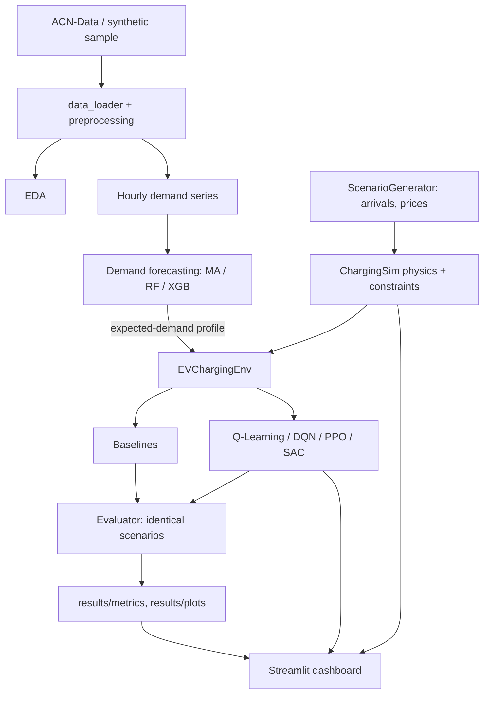

# Architecture

* `ev_simulator.py` - physics and hard constraints (no RL dependency).
* `charging_environment.py` - Gymnasium wrapper (observation, actions, reward).
* `evaluator.py` - runs any policy on identical `Scenario` objects and aggregates metrics.
* `trainer.py` - SB3 training, validation-based best-model selection, progress files used by the dashboard.
* `dashboard/` - one module per page; the Training Centre starts `scripts/train.py` as a subprocess.
